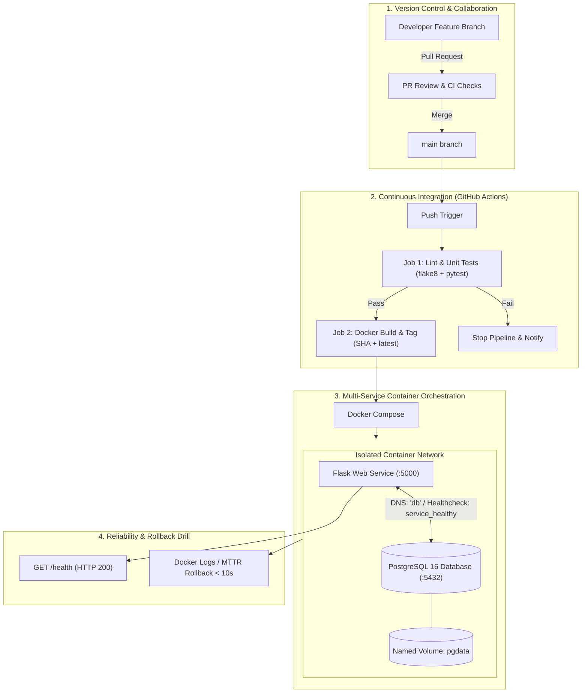

# Software DevOps and Automation Lab (CS241513)

This repository contains the complete implementation, configurations, test suites, container definitions, and CI/CD automation pipelines for the **Software DevOps and Automation Lab (CS241513)**.

---

## 🏛 Architecture Overview



---

## 📋 Course Outcomes & Experiments Map

| Experiment | Title | Module | CO | Status |
|:---:|:---|:---:|:---:|:---:|
| **Exp 1** | Repository with professional branching & merge strategy | 1 | CO1 | Completed |
| **Exp 2** | GitHub CLI + VS Code streamlined developer workflow | 1 | CO1 | Completed |
| **Exp 3** | GitHub Actions YAML for automated linting & testing | 2 | CO2 | Completed |
| **Exp 4** | Dockerfile to containerize a web application | 3 | CO3 | Completed |
| **Exp 5** | Build and tag Docker images for versioning | 3 | CO3, CO5 | Completed |
| **Exp 6** | Web app + PostgreSQL multi-service using Docker Compose | 4 | CO4 | Completed |
| **Exp 7** | Automated "Build on Push" trigger using GitHub Actions | 2, 5 | CO2, CO5 | Completed |
| **Exp 8** | Local Jenkins CI/CD freestyle job (Optional) | 5 | CO5 | Completed |
| **Exp 9** | "Rollback" simulation of containerized deployment | 5 | CO5 | Completed |
| **Exp 10**| Capstone: Full CI/CD product deployment | All | CO1–CO5 | Completed |

---

## 🚀 Quick Start Guide

### 1. Local Python Environment & Tests
```bash
# Install dependencies
pip install -r requirements.txt

# Run linter
flake8 . --max-line-length=100

# Run automated unit tests
pytest -v
```

### 2. Standalone Container Execution (Exp 4 & 5)
```bash
# Build image
docker build -t flask-demo:1.0 ./docker-app

# Run container
docker run -d -p 5000:5000 --name flask-container -e APP_ENV=production flask-demo:1.0

# Verify
curl http://localhost:5000?format=json
```

### 3. Multi-Service Stack with Docker Compose (Exp 6 & 10)
```bash
# Launch multi-service stack (Flask app + PostgreSQL 16)
docker compose up -d --build

# Verify running services & health
docker compose ps

# Initialize database
curl http://localhost:5000/init

# Test visit counter
curl http://localhost:5000/count

# Check health
curl http://localhost:5000/health

# Teardown stack
docker compose down -v
```

---

## 🧪 Application Endpoints

- `GET /`: Home page (returns JSON when requested with `format=json` or `curl`, otherwise renders responsive UI).
- `GET /health`: Health check endpoint returning `{ "status": "healthy", "service": "flask-demo" }`.
- `GET /init`: Initializes database schema (`visits` and `students` tables).
- `GET /count`: Increments and retrieves cumulative page visits using PostgreSQL persistence.
- `GET /api/students`: Renders student creation form or returns JSON student list (`?format=json`).
- `POST /api/students`: Accepts JSON or form data to record new student records (returns HTTP 201).

---

## 📖 Complete Lab Solutions & Manual Records
For full step-by-step procedures, outputs, incident reports, and viva answers for all 10 experiments, refer to [LAB_MANUAL_SOLUTIONS.md](LAB_MANUAL_SOLUTIONS.md).
